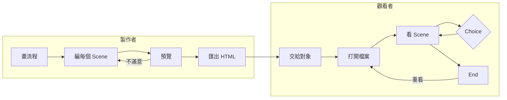

# Unsaid — 設計文件（DESIGN）

> **定位**：本專案的**規格正本**。要看「設計長什麼樣」，看這份。
>
> **與另三份文件的分工**：
> | 文件 | 職責 | 維護方式 |
> |---|---|---|
> | **DESIGN.md**（本檔） | **做什麼** — 機制、規格、結構、參數 | 現在式，就地改成最新版 |
> | [PLAN.md](PLAN.md) | **怎麼做（方向）** — 技術選型、架構決策、排程、風險、驗收 | 現在式，就地改成最新版 |
> | [TECH.md](TECH.md) | **實際怎麼實作的** — 資料契約、模組介面、不變式、驗證方式 | 現在式，跟著程式改 |
> | [DEVLOG.md](DEVLOG.md) | **發生了什麼** — 進度、決策時點、踩坑 | 過去式，只追加 |
>
> **⭐ 本檔是唯一參照原則**：任何程式或其他文件與本檔牴觸，**預設是那邊錯了**，不是本檔過時了。
> 只有 Chiao 能裁決規格變動。**AI 不得自行改寫本檔來遷就實作** —— 發現不一致時必須停下來回報，
> 列出「規格怎麼寫／實作變成怎樣／出處（檔名:行號）」，由 Chiao 三選一：改程式、改規格、
> 或列入待決（[DEVLOG.md](DEVLOG.md) §6）。
> 另三份文件與本檔牴觸時不必問，直接改它們對齊本檔。
>
> **規格有變動時的標準流程**（前提：已獲 Chiao 授權）：
> 1. 改本檔對應章節（直接改成新版，不要留舊值在內文）
> 2. 在 §0 版本紀錄加一列（寫**改了什麼**與**為什麼改**）
> 3. 若變動影響進度或技術選型，在 [DEVLOG.md](DEVLOG.md) §4 補一則 entry
> 4. 若變動推翻了先前決策，在 [DEVLOG.md](DEVLOG.md) §5 把該決策標為「已推翻」並新增一列

---

## 0. 版本紀錄

> 「原因」欄不准空白。三個月後唯一救得回來的東西就是這一欄。

| 版本 | 日期 | 變更 | 原因 |
|---|---|---|---|
| v0.1 | 2026-10-18 | 初版：設計目標、四種 node、Scene 與字元轉換規格、匯出規格、MVP 範圍 | Chiao 提出構想，與 AI 討論後收斂成第一版大綱 |
| v0.2 | 2026-10-18 | 圖層來源支援 GIF 動圖（4.2、新增 4.3.1）；新增「單一 Scene 匯出 GIF」（3、4.6.2、7）；待決 #2 涵蓋 GIF | Chiao 試完 M1 spike：效果動起來特別好，要保留會動的部分 —— 輸入要能用動圖，輸出也要能是會動的單張圖 |
| v0.3 | 2026-10-18 | 待決 #1、#2 定案：`Choice` 疊在上一個 Scene 上（4.1）；匯出檔不加工具標記（4.6） | M2 開工前 Chiao 裁決。Choice 疊在畫面上，觀看者是看著那張圖做選擇，情緒不會斷；這是一封私人的信，畫面上只該有製作者想說的話 |
| v0.4 | 2026-10-18 | 待決 #4 定案：專案檔保留縮小後的原圖（4.8）；HTML 匯出檔不含原圖（4.6.1） | M3 開工前 Chiao 裁決。自動存檔要先知道 Scene 存什麼：保留原圖才能隨時重調參數，縮小到夠重新轉換的解析度，專案檔不會一下子變很大 |
| v0.5 | 2026-10-18 | `Start`、`End` 可以掛一個畫面，規格與編輯方式同 Scene（4.1）；起始畫面改為 `Start` 的畫面＋「點一下開始」（4.7）；`End` 的「結尾文字」併入結尾畫面 | Chiao 試用 M3：開頭只有固定的「點一下開始」、結尾只有固定速度的打字機，能編的太少。Chiao 裁決直接掛一整個 Scene 畫面（文字或圖片＋全套特效），不另設一套欄位 —— 編輯方式一致，開頭與結尾也能用圖 |

---

## 1. 設計目標

### 1.1 一句話說明

Unsaid 是一個網頁工具：製作者用流程圖把一段段 **ASCII 字元畫面**串成一則訊息，
匯出成**單一 HTML 檔**，交給想傳達的對象打開、觀看、做選擇。
給不擅長用口語表達的人 —— 用字元組成的畫面與演出，代替說出口。

核心美學：**單一個字元本身是資訊，很多字元組合起來又是另一層資訊**（遠看是圖，近看是一句話）。

### 1.2 要驗證的假設 ⭐

| # | 假設 | 如果成立 → | 如果不成立 → | 怎麼判定（看什麼現象） |
|---|---|---|---|---|
| **H1** | 字元畫面（尤其「訊息填充模式」）加上特效，足以讓觀看者感受到製作者想傳達的東西 | 往下做播放器與編輯器 | 停在 M1 調轉換與特效，或重新思考呈現方式；**不往下做編輯器** | Chiao 用自己的 2～3 張圖做出畫面後，自己覺得「想拿給別人看」；給 1～2 人看，對方說得出畫面在講什麼、或有明顯反應 |
| **H2** | 匯出的單一 HTML 可以離線、在手機上完整播放，而且看起來和編輯器預覽一致 | 「帶著一個檔案給對方」這個交付方式成立 | 改走其他交付方式（列入待決，不在 MVP 內處理） | 關掉網路，用電腦與手機各開一次匯出檔，走完所有分支；畫面與預覽目視一致 |
| **H3** | 製作者不碰 JSON，只用流程編輯器與 Scene 編輯面板，就能做完一則訊息 | 工具可以給 Chiao 以外的人用 | 簡化編輯流程，或先只給自己用 | Chiao 從空白專案做完一則「5 個以上 Scene ＋ 1 個 Choice」的訊息，全程沒有打開 JSON |

> **最可能不成立的是 H1**，它也是整個專案存在的理由，所以工時優先投在 M1 視覺 spike（見 [PLAN.md](PLAN.md)「排程」）。

### 1.3 明確不驗證什麼

- 帳號、雲端存檔、多人協作 —— 沒有後端
- 觀看者端的資料回傳（不知道對方看了沒、選了什麼）
- 變數條件分支、觀看者輸入文字的分支 —— 第二階段（見 §8）
- 音效
- 商業化、社群分享預覽、SEO
- 舊瀏覽器 —— 只支援近兩年的 Chrome／Edge／Safari／Firefox（含手機版）

---

## 2. 結構

### 2.1 全貌

回到起點的兩條線：製作者端靠**預覽**（看了不滿意就回去改）；觀看者端靠 End 的**重看**（有分支時可以走另一條路）。

### 2.2 各階段拆解

| 階段 | 使用者在做什麼 | 得到什麼 | 預期時長 | 情緒／狀態預期 |
|---|---|---|---|---|
| 構思 | 製作者想清楚要說什麼、準備圖片 | 一份流程草稿 | 不定 | 猶豫、整理思緒 |
| 編排 | 在流程編輯器拉 node、連線 | 訊息的骨架 | 10～30 分鐘（假值） | 專注 |
| 雕琢 | 每個 Scene 換字元、調參數、加特效 | 自己滿意的畫面 | 主要時間花在這裡 | 玩起來、有成就感 |
| 交付 | 匯出、傳給對方 | 一個 HTML 檔 | 1 分鐘 | 緊張 |
| 觀看 | 觀看者逐一看畫面、做選擇 | **那句沒說出口的話** | 1～5 分鐘（假值） | 好奇 → 被觸動 |

---

## 3. 系統元件

| 元件 | 作用 | 輸入 | 輸出 | 本次是否實作 |
|---|---|---|---|---|
| 流程編輯器 | 拖拉 node、連線、編輯 node 屬性 | 製作者操作 | 專案資料 | ✅ |
| Scene 編輯面板（ASCII 工作室） | 圖片轉字元、換字元集、調參數、加特效 | 圖片、文字、參數 | Scene 資料 | ✅ |
| 播放器 | 依專案資料播放畫面、處理選擇 | 專案資料 | 畫面 | ✅ |
| 匯出器 | 把播放器與專案資料打包成單一 HTML；或把單一 Scene 錄成 GIF（見 4.6） | 專案資料／一個 Scene | `.html` 檔、`.gif` 檔 | ✅ |
| 專案存檔 | 自動存檔、匯入／匯出專案檔 | 專案資料 | 瀏覽器本機儲存、`.json` 檔 | ✅ |

**編輯器內的預覽與匯出的 HTML 用的是同一個播放器** —— 預覽看到的就是對方看到的。

---

## 4. 規格本體

> 標「假值」的數字是起點，實作時可以調，定案後拿掉標記。

### 4.1 Node 種類

| Node | 入口 | 出口 | 內容 |
|---|---|---|---|
| `Start` | 0 | 1 | 起始畫面（可不設）。每個專案**恰好一個** |
| `Scene` | ≥1 | 1 | 一個畫面（見 4.2） |
| `Choice` | ≥1 | 2～N（N 上限 8，假值） | 提問文字 ＋ 每個出口一段選項文字 |
| `End` | ≥1 | 0 | 結尾畫面（可不設）、是否顯示「重看」 |

- `Start` 與 `End` 的畫面**規格與 Scene 相同**（見 4.2：文字或圖片、顏色、全套特效），編輯方式也相同；
  差別只在沒有推進方式 —— `Start` 一律等觀看者點一下（見 4.7），`End` 停在那裡。
  不設畫面時：`Start` 只有「點一下開始」，`End` 是空白背景（與重看按鈕）。
- 是／否的判斷就是兩個出口的 `Choice`，**不另設判斷 node**。
- MVP 的 `Choice` 只由**觀看者自己點選**決定走哪條路。
- `Choice` 的呈現：**疊在最後一個顯示過的 Scene 上** —— 那個 Scene 停在當下那一格、整體變暗，提問與選項浮在畫面下方。
  前面沒有任何 Scene 時（`Start` 直接接 `Choice`），疊在空白背景上。
- 每個非 `End` 的 node 出口都要接到東西；編輯器要能指出沒接好的地方，匯出前擋下。

### 4.2 Scene

一個 Scene 由以下組成：

| 項目 | 規格 |
|---|---|
| 圖層 | MVP **只有一層**；資料格式要能容納多層 |
| 圖層來源 | ① 圖片轉字元（含 GIF 動圖，見 4.3.1） ② 純文字（製作者直接打字） |
| 圖層動畫 | 圖層可以有多格，各自停留指定時間、循環播放（來自 GIF 動圖）；資料格式要能容納 |
| 字元模式 | 見 4.3 |
| 顏色 | 單色（前景色＋背景色）或沿用原圖顏色（逐格上色） |
| 特效 | 進場、持續、離場各可掛特效，見 4.5 |
| 推進方式 | 點一下繼續（預設）或自動停留 N 秒 |

### 4.3 圖片轉字元

| 參數 | 規格 |
|---|---|
| 寬度（欄數） | 20～200，預設 80（假值） |
| 長寬比校正 | 依字元格實際比例校正，圖不能被壓扁或拉長 |
| 影像調整 | 亮度、對比、反相 |
| 輪廓 | 可選：用 `/ \ | -` 等字元描邊 |

兩種字元模式：

1. **密度模式**：製作者給一組字元（任意字元皆可），系統**自動量測每個字的墨量**排出亮→暗順序，依亮度挑字。
   製作者不必手動排順序。
2. **⭐ 訊息填充模式**：亮度只決定「這一格有沒有字、字多明顯」；**填進去的字依序取自製作者寫的一段話**。
   遠看是圖，近看能讀出那句話。這是 Unsaid 的招牌模式。

#### 4.3.1 GIF 動圖

| 項目 | 規格 |
|---|---|
| 轉換 | 每一格都用**同一組**轉換參數（欄數、亮度、字元模式……）轉成字元格，製作者不必逐格調 |
| 時間 | 保留原 GIF 每一格的停留時間，播完從頭循環。停留 ≤ 10 毫秒的格子當成 100 毫秒（與瀏覽器一致） |
| 格數上限 | 最多讀前 300 格（假值），超過的捨棄 |
| 與特效的關係 | 圖層動畫與特效各走各的時間：進場特效從畫面開始算，**不因為圖層換格而重播**；持續特效疊在動畫上 |
| 訊息填充模式 | 每一格都從那段話的開頭填起 —— 字會跟著亮處移動而流動 |
| 判斷方式 | 看檔案內容是不是 GIF，不看副檔名；只有一格的 GIF 當成靜態圖 |

### 4.4 中文與全形字

中文、全形標點**佔兩格寬**，所有字元格的排版、轉換、特效都要支援。
訊息填充模式填中文時，句子不能因為字寬而錯位或斷字亂掉。

### 4.5 特效（第一批）

| 特效 | 類別 | 效果 |
|---|---|---|
| 打字機 | 進場 | 字元逐一出現 |
| 解碼 | 進場 | 先是亂碼，逐格穩定成正確的字 |
| 波浪 | 持續 | 字元上下起伏 |
| 故障 | 持續 | 偶爾閃爍、錯位、換成亂碼 |
| 溶解 | 離場／轉場 | 字元隨機消失，或轉成下一個畫面的字 |
| 字雨 | 進場／持續 | 字元像雨一樣落下後就位 |

每個特效可調速度與強度；同一類別可疊加多個。

### 4.6 匯出

兩種匯出檔（HTML、GIF）都**不加任何工具標記**（例如「Made with Unsaid」）—— 畫面上只有製作者想說的話。

#### 4.6.1 整則訊息：單一 HTML

- 產出**單一 HTML 檔**，雙擊就能用瀏覽器打開，**不需要網路**。
- 檔內包含播放器與這則訊息的所有資料（含所需字型，見 §8 #3）。**不含原圖** —— 只有轉好的字元畫面。
- 匯出檔內藏一份專案資料：**把匯出檔拖回編輯器可以繼續編輯**。
- 匯出檔大小目標 ≤ 5 MB（假值）。動圖圖層的每一格都要存進去，計入這個目標。

#### 4.6.2 單一 Scene：GIF

把**一個 Scene**（含圖層動畫與特效）錄成一個會動的 GIF，給不方便開 HTML 的場合（傳訊息、貼到社群）。

| 項目 | 規格 |
|---|---|
| 範圍 | 只錄一個 Scene。**不含流程與 `Choice`** —— GIF 無法互動，整則訊息的交付仍是 HTML |
| 一致性 | 畫面與預覽一致：用同一個播放器繪製，不是錄螢幕 |
| 寬度 | 480／720／1080 px 三選一，預設 720（假值）；高度依字元格比例 |
| 每秒格數 | 10／15／20，預設 15（假值） |
| 長度 | 預設自動：涵蓋進場特效＋停留 1.5 秒、圖層動畫一整輪；有持續特效時至少 3 秒；上限 15 秒（皆假值）。製作者可改成手動指定 |
| 循環 | 可選無限循環（預設）或只播一次 |
| 靜態 | Scene 沒有動畫也沒有特效時，輸出只有一格的 GIF |

### 4.7 播放器呈現

- 直式與橫式螢幕都要能看：字元格**自動縮放到塞得進畫面**，不出現橫向捲動。
- 推進與選擇：滑鼠點擊、觸控、鍵盤（空白鍵／Enter 繼續，數字鍵或方向鍵選選項）。
- 起始畫面：`Start` 的畫面（沒設就是空白）加上「點一下開始」提示，**一定要觀看者點一下才往下**
  （讓瀏覽器允許後續特效與全螢幕，也給觀看者一點準備）。

### 4.8 專案存檔

- 編輯器**自動存檔**到瀏覽器本機，重新整理或關掉分頁不會掉進度。
- 可匯出／匯入專案檔（`.json`），用於備份或換電腦。
- 資料格式帶**版本號**，舊版專案檔要能被新版編輯器打開。
- 專案檔（自動存檔與 `.json`）**保留原圖與轉換參數**，打開後隨時能重調：
  - 靜態圖存一份縮小版，長邊 800 px（假值）—— 欄數上限 200，這個解析度已經夠重新轉換
  - GIF 動圖保留原檔
  - 從匯出的 HTML 取回的專案沒有原圖（HTML 本來就不含），只能沿用已轉好的字元畫面

---

## 5. 健檢 ⭐

> 模板的題目偏向遊戲，這裡按「一則訊息」的性質回答。

| # | 檢查項 | 回答 | 狀態 |
|---|---|---|---|
| 1 | 使用者為什麼會開始第一輪？ | 製作者：有話想說卻說不出口。觀看者：收到了某個人特地給的檔案 | ✅ |
| 2 | 一輪結束時多了什麼他真的在意的？ | 製作者：一則可以送出的訊息。觀看者：收到那句話 | ✅ |
| 3 | 那東西是否讓下一輪不一樣？ | 有分支時，觀看者重看可以走另一條路；單線訊息重看沒有差別 | ⚠️ 已知邊界 —— 刻意的，這是一封信不是遊戲 |
| 4 | 使用者要怎麼停下來？ | 觀看者走到 `End`；製作者隨時可關，自動存檔 | ✅ |
| 5 | 沒有新內容時能撐多久？ | 每則訊息本身就是內容；工具會不會被再次使用，取決於製作者有沒有新的話要說 | ⚠️ 已知邊界 |
| 6 | 有沒有階段可跳過而沒損失？ | 圖片轉字元可跳過（純文字 Scene），沒有損失；這是刻意保留的彈性 | ✅ |

### 5.1 健檢結論

四項過關、兩項已知邊界（重看價值、重複使用），沒有答不出來的題目。
兩項邊界都源自「這是一封信」的定位，不打算在 MVP 處理。

---

## 6. 與既有約束對照

| 約束 | 對應 |
|---|---|
| 工具本體放在 Chiao 的 GitHub Pages | 只能是靜態網站，沒有伺服器端程式 |
| ProjectHand 的重力實驗（Godot，字形圖集、數字粒子） | **只借用思路**（字元即資訊、字形圖集繪製），不共用程式 —— 平台不同 |

---

## 7. 本次實作範圍

| 項目 | 做 | 不做 | 原因 |
|---|---|---|---|
| Node | `Start` `Scene` `Choice` `End` | 變數條件、文字輸入分支 | 先驗證核心體驗；兩者列為第二階段 |
| Scene 圖層 | 單層 | 多層合成 | 資料格式預留，介面先不做 |
| 字元模式 | 密度、訊息填充 | —— | 訊息填充是招牌 |
| 特效 | 4.5 第一批 | 自訂特效腳本 | 範圍控制 |
| 圖層動畫 | GIF 動圖 | —— | 效果動起來最打動人（M1 回饋） |
| 交付 | 單一 HTML 匯出（整則訊息）；單一 Scene 匯出 GIF | 線上分享連結 | 需要後端；GIF 補上「不方便開 HTML」的場合 |
| 聲音 | —— | 音效、背景音樂 | 範圍控制 |

---

## 8. 待決事項

| # | 待決 | 卡住什麼 | 誰決定 |
|---|---|---|---|
| 1 | ✅ 已定案（v0.3）：`Choice` 疊在上一個 Scene 上，見 4.1 | —— | Chiao |
| 2 | ✅ 已定案（v0.3）：匯出檔不加工具標記，見 4.6 | —— | Chiao |
| 3 | 字型要不要內嵌進匯出檔？（不內嵌：對方裝置字型不同，畫面會走樣；內嵌中文字型：檔案變大，需做字型子集化） | M2 播放器、匯出大小目標 | Chiao（AI 會在 M2 提出量測數據） |
| 4 | ✅ 已定案（v0.4）：保留縮小後的原圖，見 4.8 | —— | Chiao |

---

## 9. 已排除的方案

> 設計層的排除。技術層的排除放 [PLAN.md](PLAN.md)「已排除的技術路線」。

| 方案 | 為什麼排除 |
|---|---|
| 「判斷」與「Switch」分成兩種 node | 是／否就是兩個選項的選擇；node 種類越少，編輯器越好用、播放器越好寫。見 [決策](decisions/2026-10-18-判斷與Switch合併為Choice-node.md) |
| 線上分享連結（把訊息存在伺服器上） | 需要後端與資料庫；而且個人訊息不離開製作者的電腦本身就是賣點 |
